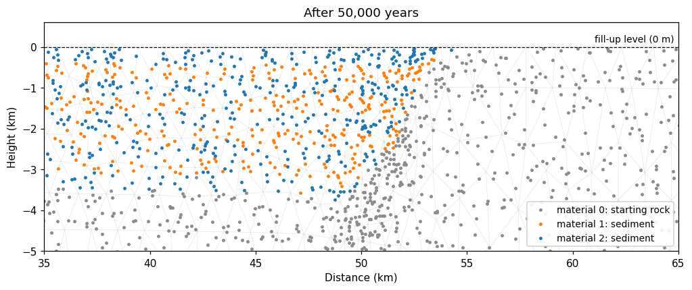

# Fill-up sedimentation

This example shows how DynEarthSol fills low ground with sediment, and how the
sediment can be drawn as layers on a cross section.



*The middle of the model after 50,000 years of extension. Each dot is a marker,
a point that carries a material id. Grey is the starting rock (material 0).
Orange and blue are the two sediment ids (materials 1 and 2). They alternate
every 5,000 years. The surface stays at 0 m because every hollow is filled up.*

## The idea in one paragraph

Pick a height, the **fill-up level**. At every time step the model checks each
point on the top surface. If a point has sunk below the fill-up level, it is
raised back up to the level, and the space this opens is counted as new
sediment. The sediment is given one material id for a while, then a second id
for the same length of time, then the first again, and so on. When both ids
have the same rock properties they behave as one sediment, but on a cross
section they show up as stripes, like bedding.

## Files here

| File | What it is |
|------|------------|
| `fill-up.cfg` | The input file. Every setting used in this example is in it, with comments. |
| `cross-section.png` | The picture above, from running `fill-up.cfg`. |
| `README.md` | This guide. |

## 1. Get the code and build the 2D program

The feature is on the `feature/fill-up-sedimentation` branch. From the top
directory of DynEarthSol:

```bash
git fetch origin
git checkout feature/fill-up-sedimentation
make ndims=2
```

This makes the program `dynearthsol2d` in the top directory. The main
`README.md` lists the libraries the build needs.

## 2. Run the example

Run it in a directory of its own, because a run writes many files:

```bash
mkdir ~/fill-up-run
cp examples/fill-up-sedimentation/fill-up.cfg ~/fill-up-run/
cd ~/fill-up-run
/path/to/DynEarthSol/dynearthsol2d fill-up.cfg
```

On a laptop this takes about five minutes. The run writes 11 frames, one every
5,000 years from 0 to 50,000 years: `fill-up.save.000000.vtkhdf` to
`fill-up.save.000010.vtkhdf`. The `.chkpt` files are for restarting a run and
can be ignored.

## 3. Look at the result

Use [ParaView](https://www.paraview.org/download/) (free).

The layers are easiest to see on the markers. Convert the frames once (needs
Python 3 with NumPy, SciPy and h5py):

```bash
python /path/to/DynEarthSol/2vtk.py -m fill-up
```

This writes, next to the frames, one mesh file per frame (`fill-up.NNNNNN.vtu`)
and one marker file per frame (`fill-up.NNNNNN.vtp`). In ParaView:

1. **File > Open**, pick the group `fill-up..vtp`, click **Apply**.
2. In the toolbar, change the colouring from *Solid Color* to `markerset.mattype`.
3. Press the **Last Frame** button to jump to 50,000 years.
4. Zoom in on the middle of the box (x = 35 to 65 km, top 5 km).

To see the mesh as well, open the group `fill-up..vtu` too and show it as
*Surface With Edges*. Colouring the mesh by `material` also shows the
sediment, but each element (triangle) gets one colour, so layers thinner than
an element blur together. The markers keep the finer detail.

## 4. Use it in your own model

Copy these lines into your own 2D input file and change the numbers.

```
[control]
surface_process_option = 2              # 2 = fill-up sedimentation
surf_base_level = 0                     # the fill-up level, in m (0 = top of the starting box)
sediment_layer_interval_in_yr = 5000    # how long each layer lasts, in years

[mat]
num_materials = 3                       # must count the two sediment ids
mattype_sediment = 1                    # first sediment id
mattype_sediment_alternate = 2          # second sediment id
```

Also add `has_marker_output = yes` to the `[sim]` section, so the frames
contain the markers.

Points to keep in mind:

- **Material ids start at 0.** With `num_materials = 3` the ids are 0, 1 and 2.
  Both sediment ids must be below `num_materials`.
- **Same properties for both sediment ids.** Each rock property is a list with
  one value per material, in id order, for example
  `rho0 = [2700, 2400, 2400]` (rock, sediment, sediment). Use the same value at
  positions 1 and 2 for every property. A list with a single value, as in
  `fill-up.cfg`, applies to every material.
- **Layer thickness and element size.** A layer can only be seen if it is at
  least about as thick as the elements. Layer thickness is roughly the
  subsidence rate times `sediment_layer_interval_in_yr`. If the layers look
  smeared, either make the interval longer or make the elements smaller
  (`resolution` in `[mesh]`; smaller elements make the run slower).
- **Only low ground is filled.** Anything above the fill-up level is left as it
  is. Nothing is eroded.
- **Without layers.** Leave `mattype_sediment_alternate` out (or set it to -1)
  and all sediment gets the single id `mattype_sediment`.
- **Deposit time.** Markers of `mattype_sediment` also record when they were
  deposited (the `time` field of the markers). Markers of the alternate id
  usually record it too, but some can show 0. The material id is always right,
  so the layers are drawn correctly.

Every parameter, with a short description, is listed by
`./dynearthsol2d --help`. `examples/defaults.cfg` shows the default value of
each.
